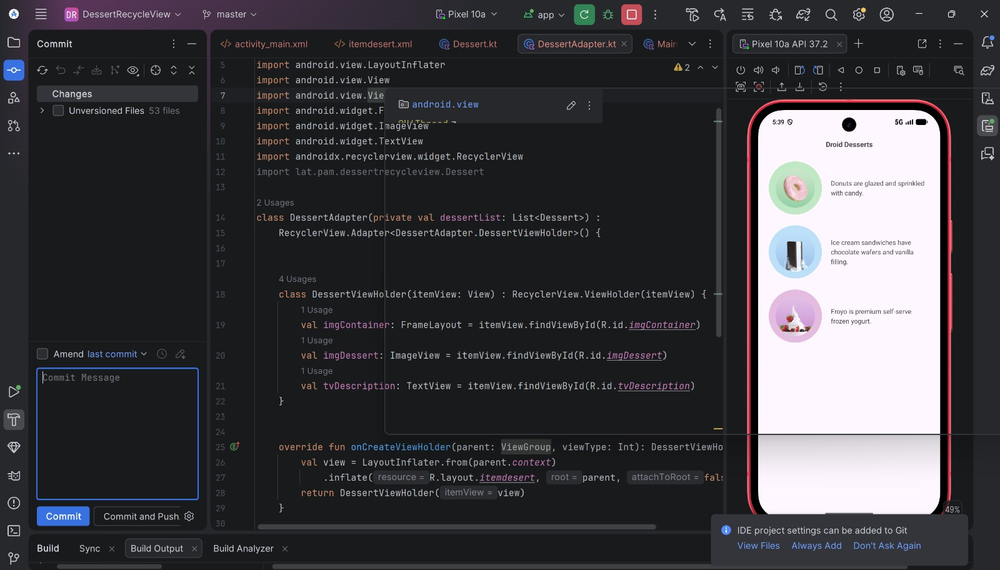

# Droid Desserts 🍩🍦🍨

Aplikasi Android sederhana berbasis **Kotlin** yang menampilkan daftar makanan penutup (*dessert*) secara efisien dan interaktif menggunakan komponen **RecyclerView** dan **CoordinatorLayout**.

---

## 📱 Tampilan Aplikasi (Preview)

<p align="center">
  
</p>

---

## 🛠️ Fitur & Spesifikasi Utama

* **RecyclerView**: Menampilkan daftar item dessert secara dinamis dan efisien.
* **Custom Layout & Styling**: Penggunaan `CoordinatorLayout`, `FrameLayout`, dan tampilan kartu (*card*) khusus untuk setiap item dessert.
* **Kotlin Native**: Seluruh logika aplikasi ditulis menggunakan bahasa pemrograman Kotlin.
* **Material Design**: Antarmuka bersih, responsif, dan mengikuti panduan UI modern.

---

## 📂 Struktur Berkas Penting

* `activity_main.xml` — Layout utama aplikasi yang berisi `RecyclerView` dan judul header.
* `itemdesert.xml` — Layout XML khusus untuk mendefinisikan tampilan tiap baris item dessert.
* `Dessert.kt` — Model data untuk menyimpan informasi item dessert.
* `DessertAdapter.kt` — Adapter untuk menghubungkan data dessert dengan tampilan `RecyclerView`.
* `MainActivity.kt` — Activity utama tempat inisialisasi data dan adapter.

---

## 🚀 Cara Menjalankan Proyek

1. **Clone Repositori Ini**:
   ```bash
   git clone [https://github.com/username-kamu/DessertRecycleView.git](https://github.com/username-kamu/DessertRecycleView.git)